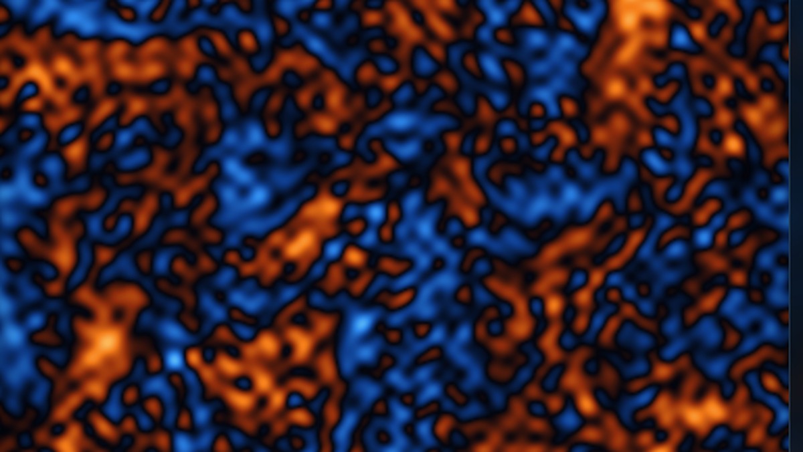
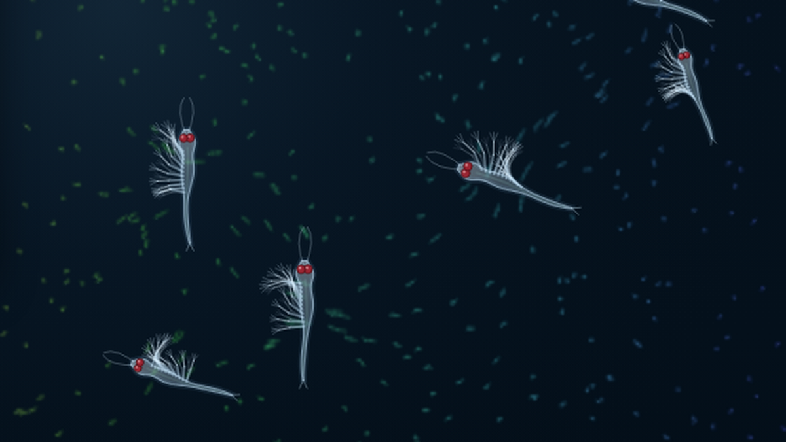

# turb2d - a 2D turbulence lab

> Session state, open items, verified numbers and measurement caveats live in
> `RESUME.md` - read that first when picking this up again.

## Two views of the same paper

| file | what it is |
|---|---|
| `turbulence.html` | the six-scene **flow** view, in the browser: one self-contained HTML file, plain JS, 128^2 spectral solver |
| `brine-shrimp.html` | the **organism** view: the brine shrimp itself, metachronal legs, schooling, dye, in one self-contained HTML file |
| `src/` (`turb2d`) | the native Rust/Windows app, same six scenes at ~3x the browser speed - **FROZEN** as the native reference, see below |

The two HTML files are a matched pair and cross-link to each other. No
dependencies, no build step, no server: double-click either one.

## Which paper

The README has said "the same paper" since it was written, and until 2026-11-19 it never said which one - there was no
title, author, DOI, arXiv id or outbound link anywhere in the repository or its history. Here it is, with the popular
account of it, because that is where the two HTML views were most plausibly read first:

- **Xinyu Si and Lei Fang**, "Biologically generated turbulent energy flux in shear flow depends on tensor geometry",
  *PNAS Nexus* **3**(2), pgae056, published 2024-02-08, doi:[10.1093/pnasnexus/pgae056](https://doi.org/10.1093/pnasnexus/pgae056).
  Preprint: [arXiv:2310.03226](https://arxiv.org/abs/2310.03226), 5 Oct 2023, then titled "... energy **cascade** ...
  depends on tensor geometry" - the published version says **flux**. The subject is the brine shrimp *Artemia salina*
  migrating in shear flow, with an artificial-jet analog experiment.
- **Stephen Ornes**, "Sea Monkeys Show Scientists How To Rewrite a Rule of Turbulence", *Quanta Magazine*, 2 October 2026,
  [quantamagazine.org](https://www.quantamagazine.org/sea-monkeys-show-scientists-how-to-rewrite-a-rule-of-turbulence-20261002/).
  "Sea monkeys" is the aquarium-trade name for *Artemia*. If the inspiration was a different write-up - an HN or Reddit
  post of either, a preprint PDF - correcting this list is one line; nothing below depends on the popular source.

**What this lab takes from it, and what it does not.** Taken: the stresslet as the rod's flow source (the paper's
swimmer), and the question of whether a biological agent reorders a 2D inverse cascade. Not taken, with the divergence
**measured** rather than assumed: the paper's 45-degree flux reversal does not reproduce here, for reasons recorded under
"Known limitations" - the rod default sat in a strain node, the coupling is viscosity-sensitive, and the flux varies 22x
with the rod's absolute angle without ever changing sign.

### `src/` is frozen (decided 2026-10-15)

`turbulence.html` is the lab that still moves; the native app is kept as the
fast local reference and as the build whose numbers the "Verified" block below
publishes. Porting the browser version's remaining features across is
deliberately **not** happening, and the deltas are listed rather than hidden:

- **Ported** in the 2026-10-15 pass, because a published claim rested on them:
  the 2/3 dealiasing on the dye advection (`turbulence.html` always applied it
  to the passive scalar; `src/solver.rs` did not, so the barrier dye was
  aliased here) and the measured rod caveat, which now names the numbers
  instead of asserting "the reversal is not guaranteed".
- **Not ported**, deliberately: named scene presets, the runtime resolution
  selector, `Save PNG`, the dark-neutral colormap, and the barrier's
  perturbation spin. So this build keeps the bright blue/orange vorticity map,
  its barrier scene starts with the perturbation *off*, and its rod scene keeps
  the original rod-at-`(pi,pi)` default - the strain node the rod caveat
  describes. The browser lab moves the rod to `(pi,pi/2)`.

The app says this itself, in the field guide entry "State of this build", so a
user of the binary is not misled about which one is current. `RESUME.md` lists
the divergences and the re-verify commands.

### Live page - published 2026-11-19

| | view | URL |
|---|---|---|
|  | flow, six 2D scenes | <https://kevinelong.github.io/sim/turbulence.html> |
|  | organism, the brine shrimp | <https://kevinelong.github.io/sim/brine-shrimp.html> |

A scene can be deep-linked and pre-warmed, which is what the thumbnails and any forum post use:
`?scene=rod&warm=1200` opens the rod at a developed state (`scene` is one of `cascade`, `rod`, `swimmers`, `mhd`, `jets`,
`barrier`; `warm` is a step count, clamped to 20,000). The landing page carries a thumbnail per link - real captures of both
views in `thumbs/`, and three drawn cards for the paper, the Quanta account and the repository - plus Open Graph metadata, so
a shared link previews with an image.

Served by GitHub Pages from this repository's `master` **root** - no build step, no workflow, no server, because each
view is one self-contained file with zero external references. Both files must stay in the same directory: they cross-link
by relative path. The repository is public since 2026-11-19 and carries `LICENSE.md = FSL-1.1-MIT` (source-available, not
OSI open source - please do not call it open source).

The earlier answer to this question (checked 2026-10-15) was "no", and it was right then: no remote, no `.github/`, no
`gh-pages` branch, no repository named `sim`. That commit is `717d556`; this section is the change since.

## What this is, and what it is not

The paper is a laboratory experiment: a thin film of salt water over magnets, a current that drives a banded shear, and real
*Artemia* swimming through it - plus a tensor-geometry argument for the angle dependence and collaborators' simulations.
This repository is not a re-implementation of that apparatus. It is a pseudo-spectral solver at 128^2 with one synthetic force
dipole standing in for the swimmer, and it was written to look at the mechanism at interactive speed.

| of the six scenes | provenance |
|---|---|
| rod / 45-degree switch | **the article's** - the stresslet swimmer, and the rod array of the 2025 follow-up |
| MHD channel | **the article's apparatus drive** - `f_x = A cos(k y)` stands in for their magnet-and-current channel |
| brine-shrimp swarm | **an extension of ours** - the article motivates billions of swimmers; its experiments used one at a time |
| dual cascade | **the textbook background** the article describes (Kraichnan and Batchelor), not their experiment |
| beta-plane zonal jets | **ours, not in the article** - Rhines arrest, added to see what stops a cascade |
| transport barrier | **ours** - the article names the barrier as a question the group is still exploring, so nothing here reproduces a result |

Incomplete by construction, and that is the point of publishing it this way: no laboratory, no real swimmers, no parameter
sweeps, a box two eddies wide, and one measured failure - the 45-degree reversal does not reproduce here (see
"Known limitations" for the numbers and why).


## Scenes

| Scene | Physics added | Verified signature |
|---|---|---|
| **Dual cascade** | none - bare forced turbulence | `Pi(k) < 0` below the forcing band: the inverse cascade |
| **Rod / 45-deg switch** | one static force dipole (the paper's stresslet for a brine shrimp) | inverse cascade persists with the rod as a probe |
| **Brine-shrimp swarm** | 24 moving force dipoles that swim, ride the flow and rotate with the local vorticity | flow sustained by swimmers alone when forcing is set to 0 |
| **MHD channel** | steady banded body force `f_x = A cos(k y)`, the Lorentz drive of the Pittsburgh apparatus | banded energy fraction = 1.000, i.e. a pure counter-flowing channel |
| **Beta-plane zonal jets** | Coriolis gradient term `-beta * v` | zonal energy fraction 2-4x the isotropic baseline, `u_rms/v_rms` about 1.6 |
| **Transport barrier** | passive scalar (dye) advected by the flow, plus an optional perturbation dipole on the interface | a stable banded shear (banded fraction 1.000) with a sharp, slow-diffusing interface |

Left panel: scene selector, per-scene knobs, shared knobs (viscosity,
large-scale friction and its scale, running, steps/frame, restart scene), live
readouts, and the two time-averaged plots. Right panel: the field guide, which
changes with the scene and explains what you are seeing and what each knob
illustrates.

## Diagnostics

Three panels, and the third is the one the paper's claim is written about:

- **`Pi(k)`, green** — the global spectral energy flux, time-averaged. The box's cascade in one number.
- **`E(k)`** — the kinetic-energy spectrum.
- **source injection `E_inj(k)`, amber** — per shell, `Re(conj(psi)·S)`: how much energy the scene's own forcing (the
  dipole, the band drive) adds at that wavenumber. This is the local quantity behind "the swimmer feeds this scale or
  drains it", and it is neither `Pi(k)` nor the same magnitude, so it gets its own axis.

`Solver.injectionCheck()` returns the per-shell sum and the physical `∫psi·S` over the grid; a test asserts they agree to
1e-6, which is how the `1/n²` normalisation was settled rather than guessed (the first version was off by exactly `n²`).

## Numerics

- Pseudo-spectral 2D Navier-Stokes in vorticity form, doubly periodic
  `[0, 2pi)^2`, 2/3-rule dealiasing, Heun step with exponential viscosity,
  adaptive CFL-limited `dt`.
- All scene sources (dipoles, banded drive) are assembled in physical space,
  transformed once per RHS evaluation, dealiased, and added.
- The beta term `-beta * v` is linear and oscillatory. Integrating it
  explicitly is *slowly unstable* (amplification 1 + (beta*dt)^4/4 per step),
  which compounds over thousands of steps and blows up; it is therefore applied
  as an exact per-mode phase rotation, Strang-split around the explicit step,
  exactly as viscosity is. This was a real bug found by the beta sweep.
- Stochastic forcing in a ring around `kf`; low-`k` Rayleigh friction, which
  drains the large-scale condensate so the inverse cascade reaches a steady
  state. The friction scale is a knob (`friction below k`).
- The dye is a passive scalar with spectral advection and diffusion.

## Diagnostics

`E(k)` and `Pi(k)`, both time-averaged: `Pi(k) = -sum_{q<=k} T(q)` with `T` the
transfer spectrum of the advective term (Pope's convention).

```
Pi < 0  ->  energy moving to LARGER scales  (inverse cascade)
Pi > 0  ->  energy moving to SMALLER scales (forward cascade)
```

Two scene-specific scalar readouts are printed live in the left panel so the
claims above are measurable, not asserted: the **banded energy fraction**
(energy in `kx = 0` modes; 1.0 = pure counter-flow) and the **zonal energy
fraction** with `u_rms/v_rms` (isotropic baseline is about `1/n`).

## Run

```
cargo run --release                          # interactive, 256^2
cargo run --release -- --n 192
cargo run --release -- --scene jets          # start in a given scene
cargo run --release -- --frames 60 --n 256   # smoke run, exits after 60 frames
cargo run --release -- --selftest 6000 128   # time-averaged E(k), Pi(k), bare scene
cargo run --release -- --scenes 6000 128     # sanity/stability run of all six scenes
cargo run --release -- --one jets 15000 96 50   # one scene, optional beta override
```

## Test

```
node --test        # 10 tests, stdlib only: see RESUME.md "Tests"
```

Observed 2026-10-15: **10 tests, 10 pass, 0 fail, 0 skipped, 105.9 s** (the
native-binary test ran rather than skipping, i.e. the exe was present and the
published cascade signature still holds).

Runs the real `Solver` lifted out of `turbulence.html` (the extraction the RESUME
documents - and that extraction is `node`, since bun is not installed here) plus
`target/release/turb2d.exe --selftest 6000 128` when the binary is built - that
test skips with a message naming the build command if it is not.


## Verified

Re-run 2026-10-15 against the frozen native build, all rows `finite=true`, wall
148.2 s for the six scenes with nothing else running (single core; 203.9 s in an
earlier contended run). Five of the six rows reproduce the previously published
block to every printed digit - the run is seeded and deterministic. The `jets`
row did **not**: the old block printed `u/v=1.23 band=0.036`, which this build
does not produce at its default `beta = 50`, and which contradicted this
README's own "`u_rms/v_rms` about 1.6" prose. Corrected to the observed values:

```
--scenes 6000 128
cascade   t=109.64 umax=2.049  E=4.8842e-01 Pi_inv=-2.3205e-03 u/v=1.03 band=0.041
rod       t= 77.67 umax=3.351  E=7.9579e-01 Pi_inv=-2.1783e-03 u/v=1.02 band=0.036
swimmers  t=120.00 umax=1.446  E=2.1858e-01 Pi_inv=-7.2670e-04 u/v=0.99 band=0.022
mhd       t=120.00 umax=0.770  E=1.4774e-01 Pi_inv=+2.6e-31     u/v=999.0 band=1.000
jets      t=120.00 umax=0.688  E=4.0907e-02 Pi_inv=-5.3559e-05 u/v=1.55 band=0.016
barrier   t=120.00 umax=0.910  E=2.0638e-01 Pi_inv=-2.5e-29     u/v=999.0 band=1.000
```

`--selftest 6000 128` (64.0 s) reproduces the dual cascade:

```
n=128 t=271.97 steps=30000 dt=0.00583 umax=4.312 E=1.38224e0 samples=2400
   k       E(k)_avg      Pi(k)_avg
   1     1.19547e-2    -1.20680e-3
   3     2.46806e-2    -2.06569e-3
   6     1.30557e-2    -2.30970e-3
   7     1.15334e-1    -1.96353e-3
   8     3.59814e-1     4.62221e-4     <- energy peak, at kf
   9     1.07743e-1     9.81601e-4
  20     2.33767e-3     3.65945e-4
  26     2.00345e-3     4.25077e-5
  27     1.81745e-3    -4.92419e-6     <- flux falls to noise past here
  47     5.48080e-4    -7.61924e-6
```

`Pi(k)` is negative through `k = 1..7` (the inverse cascade) and positive from
`k = 9` up to about `k = 26` (forward), with the energy peak at the forcing
wavenumber 8. That table is a **late-window** average (6000 burn-in steps, then
24000 averaged - see `samples=2400` in the header), and the window matters:
averaged from `t = 0` instead, the same flow still reads *negative* in the
forward band (measured through the JS extraction, 15000 steps). Two corrections
to the older wording: the inverse band is negative but **not monotone**
(`Pi(7) = -1.96e-3` is *above* `Pi(6) = -2.31e-3`), and "positive for `k >= 9`"
only holds to `k ~ 26` - past that `|Pi| < 2e-4`, at the level of the
2/3-dealiased tail, and the sign flips from bin to bin. The pinned test asserts
the bounded claim (`Pi > 0` for `k = 9..20`), which held.


Per-scene UI panels: each of the six scenes starts, renders and exits cleanly.

## Rendering: exact, not interpolated

The field is band-limited and the solver holds its exact Fourier coefficients, so
the image is **synthesized at the display resolution** (zero-pad the spectrum,
inverse transform) rather than letting the browser bilinear-upscale the coarse
raster. Verified exact: resampling the synthesized field back at the coarse
points reproduces the original bit for bit.

That matters because bilinear upscaling is not neutral. Grouped by position
within a coarse cell, the Laplacian of a bilinearly upscaled field is **exactly
zero in every cell interior and non-zero only on the cell-boundary lines** - a
literal square lattice at the upscale period (8.3 device px at 128^2), which is
plainly visible. The exact synthesis gives a uniform Laplacian (0.011 across all
sub-positions, ratio 1.00x) and no lattice.

| pipeline | error vs true field | cost per frame |
|---|---|---|
| direct bilinear 128 -> display | 14.1% | ~0 ms |
| exact to 256, then bilinear 4x | **3.8%** | 3.5 ms, every other frame |
| exact to 512, then bilinear 2x | 0.8% | 20.7 ms |
| exact to 1024 (export path only) | 0.0% | one-off |

Against a 7.7 ms solver step, the live path uses **512**: the best
accuracy-per-cost point among the synthesis sizes. `Save PNG` uses the exact path
at up to 1024 and writes the field alone, so the export has no browser resample at
all. Note the colormap is applied to the *values* at full resolution, rather than
colormapping the coarse grid and interpolating RGB (which smears the sharp band
the dark-neutral map has at zero).

The synthesis target is clamped so it can never fall *below* the solver grid -
synthesizing below `n` folds high modes onto low ones. (That clamp was wrong for
a while: at grid 512 the target was 256, silently corrupting the render.)

All three knobs are reachable from the console: `window.LAB.synthMax` (256 halves
the render cost), `synthEvery`, and `exactScale`.

### Is the residual 4x resample worth removing?

There is a `exactScale` flag (`window.LAB.exactScale = true`) that makes the field
square exactly the synthesis size, so the blit is 1:1 with no resample at all.
Measured, 128^2 grid, 2 steps/frame, 1750x1125 canvas:

| mode | synthesis | square shown | resample | fps |
|---|---|---|---|---|
| default | 256 | 1057 px (full) | 4.1x | **51** |
| 1:1 | 512 | 512 px (48%) | none | 41 |
| 1:1 | 1024 | 1024 px (97%) | none | **16.5** |

Removing the last resample costs **3x the frame time** and buys interpolation
error 3.8% -> 0.8%. It adds no information: the field is band-limited by the
solver grid, so a finer synthesis samples the same field more finely, it does not
resolve anything new. It also constrains the geometry (the square must be a power
of two device pixels, so it cannot fill the frame, and 2048 would be ~90 ms).
The residual tail is the *cheapest* step - the browser's own filter, ~0 ms of JS -
so the default keeps it, and `Save PNG` covers the exact case where it matters.

## Known limitations

**Rod scene.** It does not reproduce the paper's 45-degree flux reversal, and the
reason is now measured rather than assumed:

- The rod default sits in a strain *node*. Measured in the clean (laminar)
  banded shear: |S| = 0.0000 at (pi,pi) against 5.0011 at (pi,pi/2), with the
  ambient strain axis at exactly 45.00 deg - the qualitative claim, and a
  cleaner contrast than the "|S| = 0.067 vs 12.0, a factor of 180" this bullet
  used to quote. Recipe: rod scene, rod off, banded drive `bandAmp = 1.0`,
  `nu = 0.03`, `drag = 0.10`, 4000 steps at 128^2, measured through the solver
  extraction. The old pair does **not** reproduce under any configuration
  recorded in these notes: at the rod scene's own `nu = 2e-5`, `drag = 0.05` the
  banded state is unstable (`umax` 7.7 by t = 21, no clean node anywhere), and
  in the developed turbulent state both points read |S| = 20-50.
- Even placed correctly in a steady imposed shear (ambient strain axis a clean
  45.00 deg, rod-off flux ~1e-17 so the rod is the only source), the rod's own
  stresslet dominates the local strain, and the flux is not stationary unless
  viscosity is high enough for the rod's scale to equilibrate (window-to-window
  scatter 334% at nu=1e-4, 6% at nu=5e-3).
- In the stationary regime the flux varies smoothly by 22x with the rod's
  *absolute* angle but never changes sign, and two orientations that pure-shear
  symmetry requires to be equivalent differ by 22x. The stresslet-strain
  coupling predicts zero at both 0 and 90 deg, yet those differ 22x.

So the mechanism operating here is not the alignment coupling the paper
reports. Treat the rod as a probe, not a validated result.


**Jets scene.** The zonal signature is real but modest at this box size (2*pi
across): zonal fraction 2-4x the isotropic baseline, `u_rms/v_rms` about 1.6,
stable for beta between about 20 and 120 (beta ~ 300 suppresses it again,
because the Rossby waves outrun the eddy turnover). Visually striking
many-banded jets need a domain many jet-widths across - a larger box than is
simulated here.

**Cost of settling either of those two.** Both need a *bigger physical box*,
which is a solver change before it is a CPU bill: the domain is fixed to
`[0, 2pi)^2`, so a domain many jet-widths across needs a box-length knob (a `L`,
or every wavenumber and length scale rescaled). After that, measured on this
machine: the native step is ~2.1 ms at 128^2 and ~99 ms at 512^2, so one 512^2
run of 40k steps is about an hour single-core and a rod-angle x viscosity sweep
of the ~10-12 configurations the rod negative result used is 10-15 h; 1024^2
costs roughly 4x more per run. Not run.

